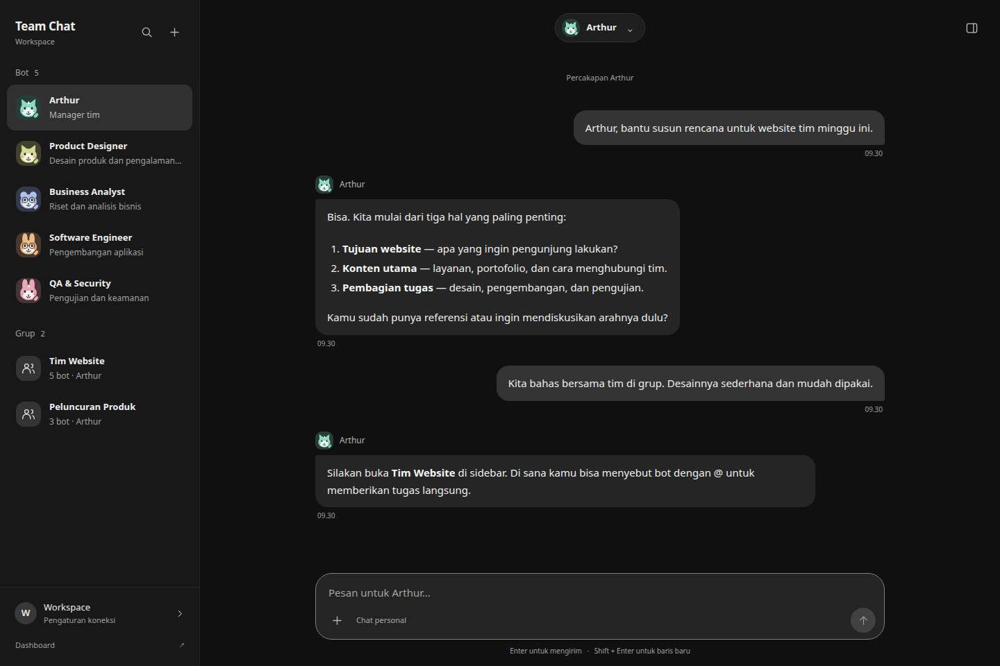

# Team Chat UI review — 9 October 2026

> Historical verification for the earlier UI revision only. The subsequent computer, avatar activity, and interactive-response changes in `team-chat-interactions.md` are untested at the user's request.

Team Chat now follows the Grok Bot conversation layout more closely: a compact bot/group sidebar, centered conversation selector, restrained dark surfaces, sender identities, a bottom composer, and an on-demand detail drawer. The marketplace interface and its JavaScript/styles were removed. Its old HTML URL redirects to Team Chat so existing bookmarks keep working.

## Scope and reference

- Updated `UI-DEV/team.html`, `UI-DEV/team.css`, and `UI-DEV/team.js`, preserving the local avatar, attachment, configuration, skill, and computer-preview functionality.
- Removed the marketplace frontend assets. The backend marketplace API was not changed by this UI task.
- Reference: the observed create menu, roster, group sender/mention behavior, details, and computer panel documented in `/home/bagas/Bagas-Project/docs/grok-reverse-engineering.md`.
- The original Grok audit screenshots in `/tmp/grok-research-tUACp34j/` were no longer available. This is an implementation of the documented interaction patterns, not a verified pixel-identical reproduction of the current Grok app.
- Existing unrelated working-tree changes were retained. No deployment or real bot message was performed.

## Design decisions

The user's direction is Grok Bot, with antislop applied during implementation. ENERGY 1 / RHYTHM 2 / MOTION 1: conversation is the focal point, while the sidebar stays compact and predictable. Quiet charcoal surfaces distinguish navigation, messages, and editing without decorative effects. Existing companion avatars retain each bot's identity; the restrained mint accent identifies mentions, working status, and keyboard focus. Rounded message corners separate incoming and outgoing messages. Shadows are reserved for overlays. Motion is limited to newly arriving messages and active bot feedback, and is disabled under reduced-motion preferences.

The user's explicit request to resemble Grok takes precedence over antislop's default recommendation against imitating other products. No new image asset or external font was needed.

## Interaction changes

- The plus menu offers direct chat or group creation, with the corresponding form selected immediately.
- Search has an explicit no-results state; closing search clears its filter.
- Draft text, selected mention identities, and attachments stay with their own conversation while the page remains open. These drafts are held in memory, not persisted across a reload.
- Send is disabled for empty messages, pending uploads, and failed attachments. IME composition does not accidentally submit a message.
- Mention suggestions support Arrow Up/Down, Enter/Tab selection, and Escape dismissal.
- Failed sends restore the draft to its original conversation, including when another chat is selected before the error arrives.
- Attachment uploads capture their destination room before awaiting network requests.
- The latest-message control returns to the bottom without forcing a reader away from earlier messages. Viewport changes keep the bottom anchored when already following the conversation.
- Mobile navigation has a dismissible backdrop, keyboard focus containment, Escape dismissal, and focus return. Detail panels also contain keyboard focus when displayed as an overlay.
- Group creation validates a nonblank name and manager, and disables submission while creating the group.

## Verification

Browser checks ran in headless Chrome through Playwright against a local static server with a mocked API. All names, transcript messages, and credentials used by that browser session were test fixtures; screenshots are UI evidence, not evidence of live agent execution.

**16/16 browser checks passed:** initial state/no marketplace, independent drafts, search, group creation, keyboard mentions and request payload, attachments, failed-send restoration after changing rooms, bot details/configuration/skill controls, transcript scrolling, responsive layout at 320/390/768/1440 pixels, mobile drawers and focus, reduced motion, offline feedback, marketplace redirect, missing-credential state, and absence of JavaScript errors.

The local browser check script is `/tmp/team-chat-review/check.cjs`; it uses the bundled Playwright package and `/opt/google/chrome/chrome`. Its fixture server was `http://127.0.0.1:8765`.

**11/11 existing Node tests passed:**

```sh
node --test --test-reporter=tap tests/arthur_ui_session_lifecycle.test.cjs tests/bot_avatar.test.cjs
```

The avatar test harness now supplies the ResizeObserver/matchMedia browser APIs used by responsive chat. Its CSS assertions tolerate formatting whitespace. JavaScript syntax checks and `git diff --check` also passed. This static UI has no bundle build step.

## Antislop delivery gate

- PASS — Hard gate: UI changes have real handlers and readable labels; group inputs validate; browser checks exercised empty, loading, offline, and failure states; screenshots were inspected at desktop and mobile sizes. Only the existing dark theme is shipped.
- PASS — Purpose gate: charcoal surfaces support hierarchy; mint supports mentions and focus; existing avatars identify bots; control icons indicate search, create, attachments, send, and panels; shadows indicate overlay elevation. No decorative image generation or external assets.
- PASS — Liveliness: ENERGY 1 / RHYTHM 2 / MOTION 1 matches the user's quiet chat-workspace direction; avatar identities and mention accents remain visible while conversation gets the largest area.
- PASS — Craftsmanship: keyboard mention selection, drawer focus behavior, responsive composer, per-chat drafts, attachment handling, send failure recovery, reduced motion, and existing avatar/session regressions passed the scoped checks above. Live backend execution and deployment remain outside this verification.

## Screenshots

- [Desktop direct chat](screenshots/team-chat/desktop.png)
- [Desktop group](screenshots/team-chat/group.png)
- [Mobile conversation](screenshots/team-chat/mobile.png)
- [Mobile sidebar](screenshots/team-chat/mobile-sidebar.png)


